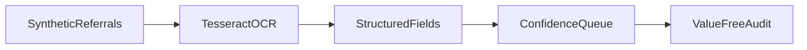

1. Extract structured data from messy synthetic referrals and route exceptions to a human.

2. Result:
   Synthetic referrals OCR evaluated: 24  
   Referral-ID accuracy: 1.0  
   Seeded identifier leaks in logs: 0  

   Measured with `make bench`: [raw results](evidence/bench.json), [command output](evidence/checks.log), [environment](evidence/environment.json).

3. Architecture:


4. Run it:
```sh
make setup
make lint test bench
make demo
```

5. Decisions and limits: Synthetic healthcare-style records only; no real PHI. Real OCR is evaluated against generated ground truth with rotation, downsampling and blur. Per-field table is evidence/field-table.md. The exception queue contains document IDs, missing field names and confidence, never patient field values. Audit logs use a value-free schema rather than attempting general PHI recognition. Zero leaks refers only to tested seeded identifiers, including a failure-path secret sentinel. System tesseract executable is required; CI installs it. This is a local queue/report demo, not a payer or clinical system.

6. Next: Add a human-review interface with authenticated access and a larger synthetic layout corpus.
